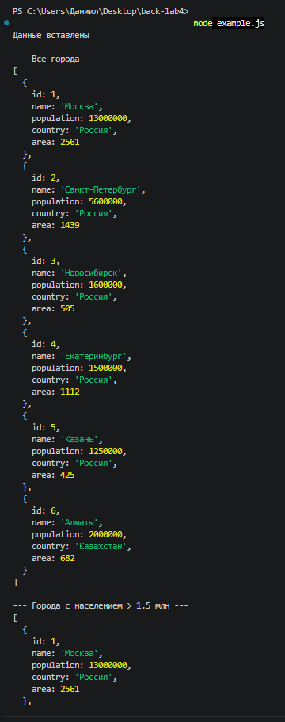
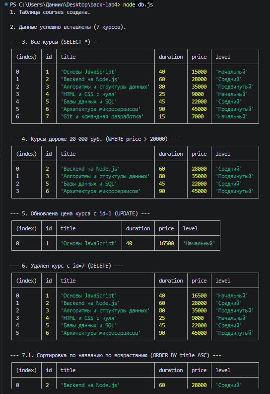
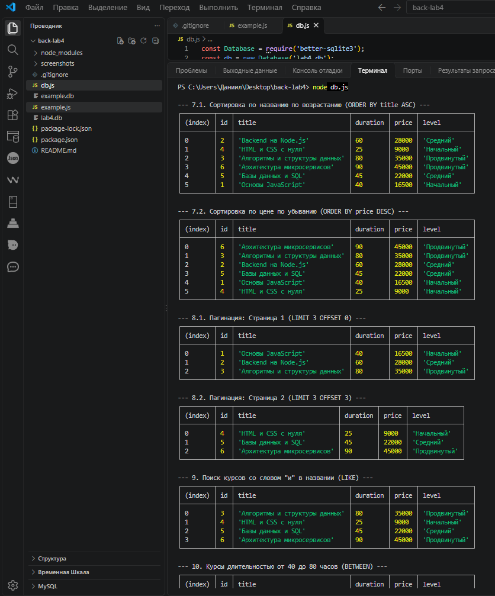
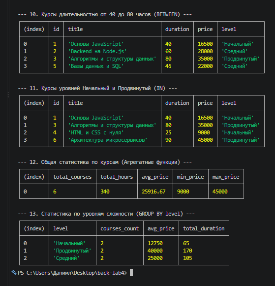

# Лабораторная работа №4. Основы SQL. Работа с SQLite

**Выполнил:** Романов Даниил

**Группа:** \[ПИЖ-б-о-25.2]

**Вариант:** 9 (Средний уровень)

**СУБД:** SQLite (`better-sqlite3`, Node.js)

## 1. Цель работы

Освоить базовые операции языка SQL, научиться создавать таблицы в реляционной базе данных SQLite, наполнять их данными, выполнять выборку (с фильтрацией, сортировкой, пагинацией и агрегацией), обновление и удаление записей, а также понять разницу между хранением данных в оперативной памяти и в локальной СУБД.

## 2. Теоретическое обоснование

**SQL (Structured Query Language)** — декларативный язык структурированных запросов для работы с реляционными базами данных. Он включает подмножества команд для определения структуры БД (**DDL**: `CREATE`, `ALTER`, `DROP`), манипулирования данными (**DML**: `SELECT`, `INSERT`, `UPDATE`, `DELETE`), управления доступом (**DCL**) и транзакциями (**TCL**).

**SQLite** — встроенная (embedded) реляционная СУБД, хранящая всю базу данных в одном локальном файле (например, `lab4.db`). В отличие от клиент-серверных СУБД (PostgreSQL, MySQL), SQLite не требует запуска отдельного серверного процесса, настройки пользователей и сетевых портов, поддерживает ACID-транзакции и идеально подходит для прототипирования и локальной разработки.

В отличие от работы с массивами и объектами в оперативной памяти (как в предыдущих лабораторных работах), использование SQLite обеспечивает сохранность данных между перезапусками приложения и позволяет эффективно фильтровать, сортировать и агрегировать записи средствами самой СУБД.

## 3. Выполнение практического примера

Команда для запуска практического примера:

```bash
node example.js
```

Результат выполнения скрипта `example.js` (работа с таблицей `cities`):



## 4. Выполнение индивидуального задания (Вариант 9 — Средний уровень)

Для Варианта 9 создана таблица `courses` (курсы) с полями `id`, `title`, `duration`, `price` и `level`.

### Код скрипта `db.js`

```javascript
const Database = require('better-sqlite3');
const db = new Database('lab4.db');

// 1. Создание таблицы (CREATE TABLE)
db.exec(`
  CREATE TABLE IF NOT EXISTS courses (
    id INTEGER PRIMARY KEY AUTOINCREMENT,
    title TEXT NOT NULL,
    duration INTEGER,
    price REAL,
    level TEXT DEFAULT 'Начальный'
  )
`);
console.log('1. Таблица courses создана.');

// Очищаем таблицу перед запуском, чтобы при повторных тестах данные не дублировались
db.exec('DELETE FROM courses');
db.exec("DELETE FROM sqlite_sequence WHERE name='courses'");

// 2. Вставка данных (INSERT - минимум 5 записей, берём 7 для наглядной пагинации и группировки)
const insert = db.prepare(`
  INSERT INTO courses (title, duration, price, level) 
  VALUES (?, ?, ?, ?)
`);

const initialCourses = [
  ['Основы JavaScript', 40, 15000, 'Начальный'],
  ['Backend на Node.js', 60, 28000, 'Средний'],
  ['Алгоритмы и структуры данных', 80, 35000, 'Продвинутый'],
  ['HTML и CSS с нуля', 25, 9000, 'Начальный'],
  ['Базы данных и SQL', 45, 22000, 'Средний'],
  ['Архитектура микросервисов', 90, 45000, 'Продвинутый'],
  ['Git и командная разработка', 15, 7000, 'Начальный']
];

for (const course of initialCourses) {
  insert.run(...course);
}
console.log('\n2. Данные успешно вставлены (7 курсов).');

// 3. Выборка всех записей (SELECT *)
console.log('\n--- 3. Все курсы (SELECT *) ---');
console.table(db.prepare('SELECT * FROM courses').all());

// 4. Фильтрация по одному полю (SELECT с WHERE)
console.log('\n--- 4. Курсы дороже 20 000 руб. (WHERE price > 20000) ---');
console.table(db.prepare('SELECT * FROM courses WHERE price > ?').all(20000));

// 5. Обновление одной записи (UPDATE)
db.prepare('UPDATE courses SET price = ? WHERE id = ?').run(16500, 1);
console.log('\n--- 5. Обновлена цена курса с id=1 (UPDATE) ---');
console.table(db.prepare('SELECT * FROM courses WHERE id = 1').all());

// 6. Удаление одной записи (DELETE)
db.prepare('DELETE FROM courses WHERE id = ?').run(7);
console.log('\n--- 6. Удалён курс с id=7 (DELETE) ---');
console.table(db.prepare('SELECT * FROM courses').all());

// 7. Сортировка по возрастанию и убыванию (ORDER BY по title и price)
console.log('\n--- 7.1. Сортировка по названию по возрастанию (ORDER BY title ASC) ---');
console.table(db.prepare('SELECT * FROM courses ORDER BY title ASC').all());

console.log('\n--- 7.2. Сортировка по цене по убыванию (ORDER BY price DESC) ---');
console.table(db.prepare('SELECT * FROM courses ORDER BY price DESC').all());

// 8. Пагинация: 2 страницы по 3 записи (LIMIT и OFFSET)
console.log('\n--- 8.1. Пагинация: Страница 1 (LIMIT 3 OFFSET 0) ---');
console.table(db.prepare('SELECT * FROM courses LIMIT 3 OFFSET 0').all());

console.log('\n--- 8.2. Пагинация: Страница 2 (LIMIT 3 OFFSET 3) ---');
console.table(db.prepare('SELECT * FROM courses LIMIT 3 OFFSET 3').all());

// 9. Поиск по подстроке (LIKE)
console.log('\n--- 9. Поиск курсов со словом "и" в названии (LIKE) ---');
console.table(db.prepare('SELECT * FROM courses WHERE title LIKE ?').all('%и%'));

// 10. Выбор в диапазоне (BETWEEN)
console.log('\n--- 10. Курсы длительностью от 40 до 80 часов (BETWEEN) ---');
console.table(db.prepare('SELECT * FROM courses WHERE duration BETWEEN ? AND ?').all(40, 80));

// 11. Выбор из списка значений (IN)
console.log('\n--- 11. Курсы уровней Начальный и Продвинутый (IN) ---');
console.table(db.prepare("SELECT * FROM courses WHERE level IN ('Начальный', 'Продвинутый')").all());

// 12. Агрегатные функции (COUNT, AVG, MAX, MIN, SUM)
console.log('\n--- 12. Общая статистика по курсам (Агрегатные функции) ---');
const stats = db.prepare(`
  SELECT 
    COUNT(*) AS total_courses,
    SUM(duration) AS total_hours,
    ROUND(AVG(price), 2) AS avg_price,
    MIN(price) AS min_price,
    MAX(price) AS max_price
  FROM courses
`).get();
console.table([stats]);

// 13. Группировка по полю level (GROUP BY)
console.log('\n--- 13. Статистика по уровням сложности (GROUP BY level) ---');
const grouped = db.prepare(`
  SELECT 
    level,
    COUNT(*) AS courses_count,
    ROUND(AVG(price), 2) AS avg_price,
    SUM(duration) AS total_duration
  FROM courses
  GROUP BY level
`).all();
console.table(grouped);

db.close();
```

### Команда запуска и скриншоты выполнения

```bash
node db.js
```







## 5. Ответы на контрольные вопросы

1. **Что такое SQL? Для чего он используется?**  
   SQL (Structured Query Language) — декларативный язык структурированных запросов, используемый для создания структуры реляционных баз данных (DDL), управления данными (DML), разграничения прав доступа (DCL) и управления транзакциями (TCL).

2. **Что такое SQLite? Чем он отличается от PostgreSQL/MySQL?**  
   SQLite — встроенная (embedded) реляционная СУБД, хранящая всю базу данных в одном локальном файле без необходимости запуска отдельного серверного процесса, настройки пользователей и портов. В отличие от неё, PostgreSQL и MySQL являются клиент-серверными СУБД, рассчитанными на сетевой доступ, высокие нагрузки и конкурентную многопользовательскую запись.

3. **Какие основные типы данных в SQLite?**  
   SQLite поддерживает 5 основных типов данных (классов хранения): `INTEGER` (целые числа), `REAL` (числа с плавающей точкой), `TEXT` (текстовые строки), `BLOB` (бинарные данные) и `NULL` (отсутствие значения).

4. **Как создать таблицу? Что такое PRIMARY KEY?**  
   Таблица создаётся командой `CREATE TABLE имя_таблицы (имя_колонки тип ограничения, ...);`. `PRIMARY KEY` (первичный ключ) — это ограничение, которое однозначно идентифицирует каждую запись в таблице (значения в этом столбце должны быть уникальными и не могут быть `NULL`).

5. **Как вставить данные? Что делает INSERT?**  
   Команда `INSERT INTO таблица (колонка1, колонка2) VALUES (значение1, значение2);` добавляет одну или несколько новых строк с данными в указанную таблицу.

6. **Как выбрать все данные из таблицы?**  
   Для выборки всех столбцов и всех строк используется запрос `SELECT * FROM имя_таблицы;`.

7. **Как выбрать данные с условием? Что такое WHERE?**  
   Для фильтрации записей применяется оператор `WHERE`: `SELECT * FROM имя_таблицы WHERE условие;`. Он оставляет в выборке только те строки, для которых заданное логическое условие истинно.

8. **Как обновить данные? Что делает UPDATE?**  
   Команда `UPDATE имя_таблицы SET колонка = новое_значение WHERE условие;` изменяет значения указанных полей в существующих строках, подходящих под условие `WHERE`.

9. **Как удалить данные? Что делает DELETE?**  
   Команда `DELETE FROM имя_таблицы WHERE условие;` удаляет из таблицы строки, удовлетворяющие условию. Если не указать `WHERE`, будут удалены все записи из таблицы.

10. **Что такое AUTOINCREMENT?**  
    Ключевое слово, используемое вместе с `INTEGER PRIMARY KEY`, которое автоматически генерирует и увеличивает числовой идентификатор (`id`) на единицу при добавлении каждой новой записи.

11. **Как отсортировать данные? Что делает ORDER BY?**  
    Для сортировки результатов используется оператор `ORDER BY колонка [ASC | DESC]`. Ключевое слово `ASC` задаёт сортировку по возрастанию (используется по умолчанию), а `DESC` — по убыванию.

12. **Как ограничить количество строк? Что такое LIMIT и OFFSET?**  
    Оператор `LIMIT N` ограничивает количество возвращаемых строк числом $N$, а `OFFSET M` указывает, сколько первых строк необходимо пропустить перед началом вывода.

13. **Как реализовать поиск по подстроке? Что такое LIKE?**  
    Для поиска по шаблону применяется оператор `LIKE` в условии `WHERE`: `WHERE колонка LIKE '%подстрока%'`. Спецсимвол `%` заменяет любое количество любых символов, а `_` — ровно один любой символ.

14. **Как выбрать данные в диапазоне? Что такое BETWEEN?**  
    Оператор `BETWEEN` проверяет попадание значения в заданный интервал включительно: `WHERE колонка BETWEEN минимум AND максимум`.

15. **Как выбрать данные из списка? Что такое IN?**  
    Оператор `IN` проверяет, совпадает ли значение поля с любым из перечисленных в списке значений: `WHERE колонка IN (значение1, значение2, ...)`.

16. **Какие агрегатные функции вы знаете?**  
    Основные агрегатные функции SQL: `COUNT()` (подсчёт количества строк), `SUM()` (сумма значений), `AVG()` (среднее арифметическое), `MIN()` (минимальное значение) и `MAX()` (максимальное значение).

17. **Что такое GROUP BY? Для чего используется?**  
    Оператор `GROUP BY колонка` объединяет строки с одинаковыми значениями в указанном столбце в единые группы, что позволяет применять агрегатные функции (`COUNT`, `AVG`, `SUM` и др.) отдельно для каждой группы.

18. **Чем отличается WHERE от HAVING?**  
    Оператор `WHERE` фильтрует отдельные строки таблицы **до** их группировки и не может содержать агрегатные функции. Оператор `HAVING` фильтрует уже сформированные группы **после** выполнения `GROUP BY` и работает с результатами агрегатных функций.

19. **Как реализовать пагинацию через SQL?**  
    Пагинация реализуется комбинацией операторов `LIMIT` и `OFFSET`: для вывода страницы с номером $P$ (начиная с 1) при размере страницы $S$ используется выражение `LIMIT S OFFSET (P - 1) * S`.

20. **Как избежать SQL-инъекций? Что такое параметризованные запросы?**  
    Чтобы избежать SQL-инъекций, нельзя формировать SQL-запросы путём прямой конкатенации строк с пользовательским вводом. Вместо этого используются параметризованные (подготовленные) запросы с плейсхолдерами (`?` в SQLite), в которых параметры передаются отдельно от текста команды и безопасно экранируются драйвером БД.

## 6. Вывод

В ходе лабораторной работы были изучены основы языка SQL и принципы работы с локальной реляционной СУБД SQLite в среде Node.js с помощью библиотеки `better-sqlite3`. Была спроектирована таблица `courses`, выполнены базовые CRUD-операции (`CREATE TABLE`, `INSERT`, `SELECT`, `UPDATE`, `DELETE`), а также освоены продвинутые выборки: сортировка (`ORDER BY`), постраничный вывод (`LIMIT` и `OFFSET`), фильтрация (`WHERE`, `LIKE`, `BETWEEN`, `IN`), агрегатные функции и группировка данных (`GROUP BY`).

## 7. Список использованных источников

1. Официальный сайт SQLite — https://www.sqlite.org/
2. SQLite Tutorial — https://www.sqlitetutorial.net/
3. Документация пакета `better-sqlite3` — https://www.npmjs.com/package/better-sqlite3
4. Справочник по SQL (MDN) — https://developer.mozilla.org/ru/docs/Glossary/SQL
